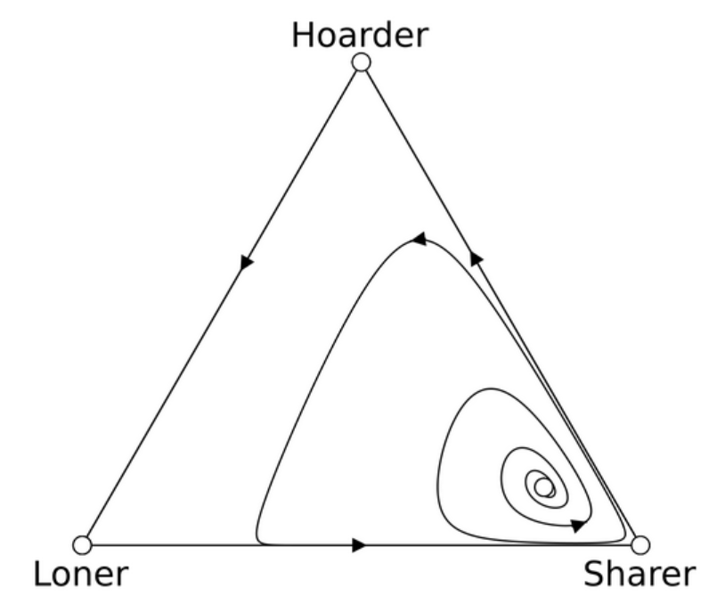
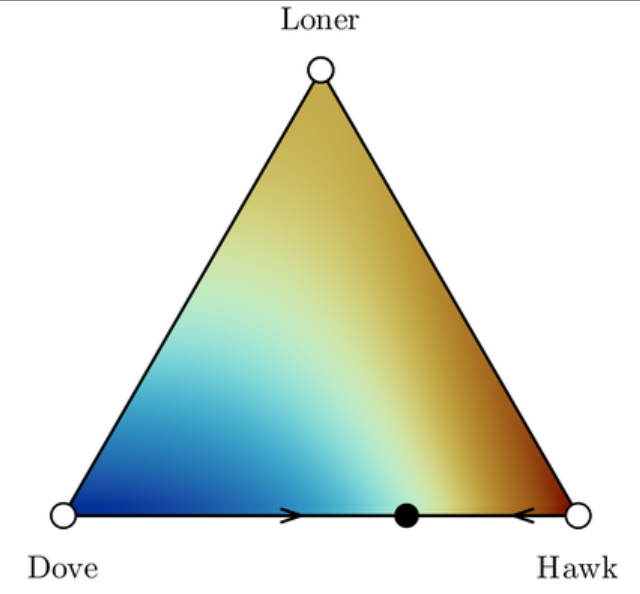
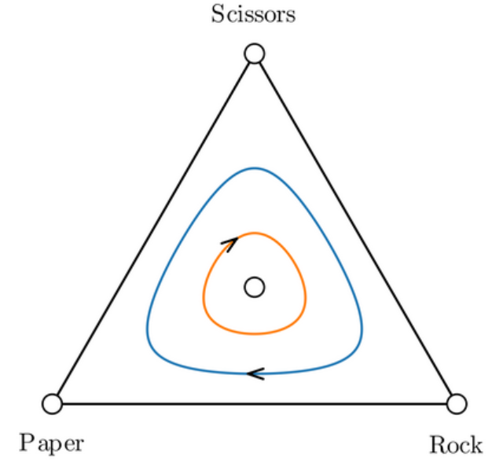
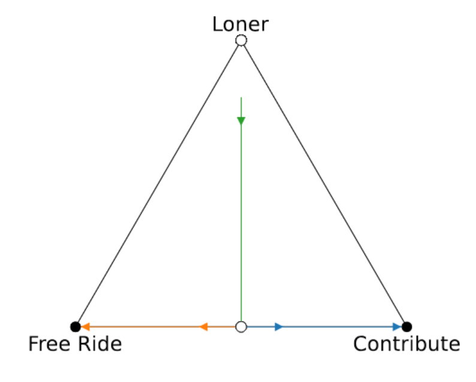
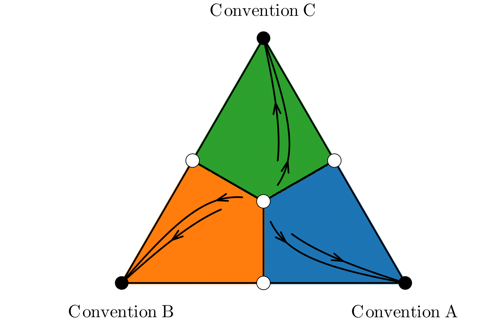
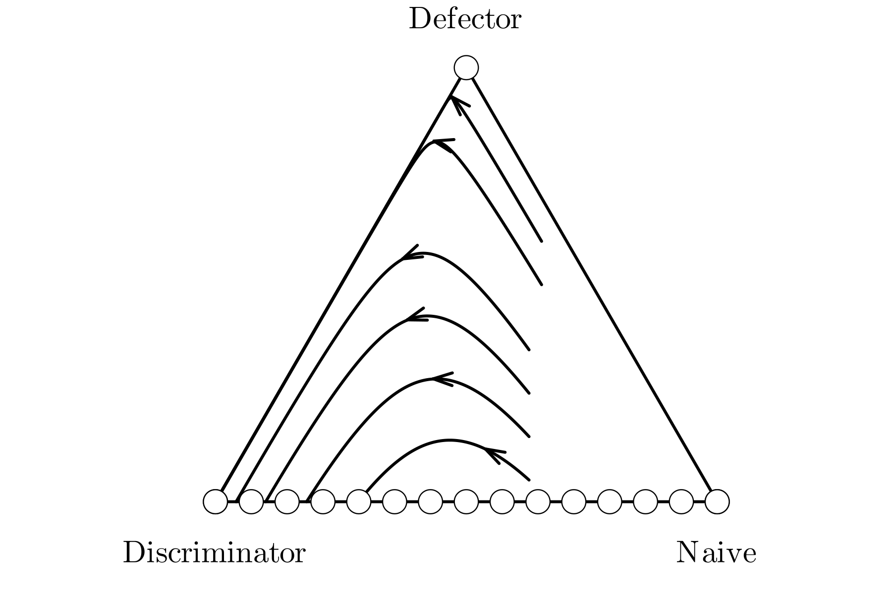

# BaryPlots.jl



BaryPlots is a Julia package designed to visualize the evolutionary dynamics of strategies in population games, inspired by Richard McElreath's [baryplot R package](https://github.com/rmcelreath/baryplot). It provides tools for plotting trajectories on a ternary simplex, determining equilibria, and visualizing payoff landscapes using contour plots.

### Installation

To install BaryPlots, simply add the package from your local environment:

```julia

] add BaryPlots

```

or clone into the repository:

```julia

] add https://github.com/datadreamscorp/BaryPlots.jl

```

### Overview

BaryPlots focuses on simulating and visualizing the evolution of strategy frequencies over time in evolutionary games. The core of the package is the plot_evolution function, which allows you to simulate population dynamics under various payoff structures and plot the results in a visually clear format, including contour plots to visualize the payoff landscape.

#### The `plot_evolution` Function

The `plot_evolution` function simulates and plots the evolution of strategy frequencies over time using replicator dynamics. This function is especially useful in evolutionary game theory to track how different strategies fare in a population.

```julia

plot_evolution(
        payoff_functions::Tuple{Function, Function, Function},
        x0_list::Vector{<:AbstractVector{<:Real}},
        tspan::Tuple{Real, Real};
        labels::Vector{String} = ["Strategy 1", "Strategy 2", "Strategy 3"],
        extra_params::NamedTuple = NamedTuple(),
        steady_state_tol::Real = 1e-6,
        arrow_list::Vector{Vector{Int}} = Vector{Vector{Int}}(),
        trajectory_labels::Vector{String} = String[],
        trajectory_colors::AbstractVector = Any[],
        trajectory_linewidth::Real = 2,
        equilibria_kwargs::NamedTuple = (;),
        markersize::Real = 9,
        markerstrokewidth::Real = 1.0,
        colored_trajectories::Bool = false,
        contour::Bool = false,
        contour_color::Symbol = :roma,
        contour_resolution::Integer = 150,
        colorbar::Bool = false,
        triangle_linewidth::Real = 2,
        legend::Bool = false,
        margin::Integer = 2,
        dpi::Integer = 300,
        plot_basins::Bool = false,
        basin_resolution::Integer = 100,
        basin_convergence_tol::Real = 0.1,
        basin_shade::Bool = false,
        basin_colors::AbstractVector = [],
        basin_alpha::Real = 0.3,
        basin_boundary_color = :black,
        basin_boundary_linewidth::Real = 2,
        basin_boundary_linestyle::Symbol = :dash,
    )::Plots.Plot

```

Numeric arguments accept any real type that converts unambiguously to a float, so
`markersize = 10`, `tspan = (0, 100)` and `steady_state_tol = 1//1000000` all work.

#### Parameters:

    payoff_functions: A tuple of three payoff functions corresponding to each strategy.

    x0_list: A vector of initial conditions (strategy frequencies) to simulate trajectories.
    
    tspan: A tuple representing the time span for the simulation, e.g., (0.0, 1000.0).
    
    labels: Labels for the corners of the simplex. Default is ["Strategy 1", "Strategy 2", "Strategy 3"].
    
    extra_params: A NamedTuple that can pass extra parameters to the payoff functions.
    
    steady_state_tol: The tolerance level for determining when a trajectory reaches steady state.
    
    arrow_list: A list of indices to draw arrows along the trajectory, useful for indicating the direction of change.
    
    trajectory_labels: Labels for each trajectory. Defaults to a numbered list.
    
    trajectory_colors: Colors for each trajectory. If colored_trajectories is false (default), all trajectories will be black.
    
    trajectory_linewidth: Line width for the trajectory lines.
    
    equilibria_kwargs: A NamedTuple forwarded verbatim to find_equilibria. Accepts
        num_initial_guesses, solver_tol, equilibrium_tol, validity_tol and stability_tol,
        e.g. equilibria_kwargs = (num_initial_guesses = 200, equilibrium_tol = 1e-3).
    
    markersize: Size of equilibrium markers.
    
    markerstrokewidth: Stroke width of the equilibrium marker boundary.
    
    colored_trajectories: Boolean flag indicating whether to color the trajectories or keep them black.
    
    contour: Boolean flag to include a filled contour plot of the average payoffs over the simplex.
    
    contour_resolution: Resolution of the contour plot grid.
    
    colorbar: Boolean flag to include a color bar in the contour plot.
    
    triangle_linewidth: Line width for the simplex triangle.
    
    legend: Boolean flag to include a legend.
    
    margin: Margin to exclude points near the boundaries in the contour plot.
    
    dpi: Dots per inch for the plot resolution.
    
    plot_basins: Draw the basins of attraction and their separatrices. See below.
    
    basin_resolution: Grid resolution used to classify basins.
    
    basin_convergence_tol: How close a trajectory must land to a stable equilibrium to
        count as having converged to it.
    
    basin_shade: Fill each basin with a translucent color as well as drawing the separatrix.
    
    basin_colors: Colors for each basin. Auto-selected from :tab10 if empty.
    
    basin_alpha: Transparency of the basin shading.
    
    basin_boundary_color / basin_boundary_linewidth / basin_boundary_linestyle: Styling
        for the separatrix line.


### Example 1: Basic Hawk-Dove Dynamics



In this example, we simulate the Hawk-Dove game and include a contour plot to visualize the average payoff landscape over the simplex.

```julia

using BaryPlots, LaTeXStrings

# Payoff functions for Hawk-Dove game
function hd_payoff_H(x, t, params)
    H, D = x[1], x[2]
    return (-1) * H + 4 * D  # Payoff for Hawk
end

function hd_payoff_D(x, t, params)
    H, D = x[1], x[2]
    return 0 * H + 2 * D  # Payoff for Dove
end

function hd_payoff_dummy(x, t, params)
    return 0.0  # Dummy payoff function for the third strategy
end

```

#### Simulate and plot the evolution

```julia

payoff_functions = (
    hd_payoff_H, 
    hd_payoff_D, 
    hd_payoff_dummy
    )

initial_conditions = [
        [0.99, 0.01, 0.0], 
        [0.01, 0.99, 0.0]
        ]# Two starting points

# Simulate and plot
p = plot_evolution(
    payoff_functions,
    initial_conditions,
    (0.0, 100.0);
    labels = [L"\mathrm{Hawk", L"\mathrm{Dove}", L"\mathrm{Loner}"],
    arrow_list = [ [300], [300] ],
    contour = true,              # Include contour plot
)

display(p)
```

This code simulates the evolution of the Hawk-Dove game starting from two different initial conditions. The strategies "Hawk" and "Dove" evolve over time, and the dynamics are plotted on a simplex with a contour plot showing the average payoff landscape. The contour plot helps visualize regions of high and low average payoffs, providing deeper insight into the dynamics.


### Example 2: Rock-Paper-Scissors Game



In this example, we simulate the evolution of strategies in the Rock-Paper-Scissors game, where each strategy cyclically dominates another.

```julia

# Payoff for Rock (R)
function rps_payoff_R(x, t, params)
    R, P, S = x[1], x[2], x[3]
    return 0 * R + 1 * S - 1 * P  # Rock beats Scissors
end

# Payoff for Paper (P)
function rps_payoff_P(x, t, params)
    R, P, S = x[1], x[2], x[3]
    return 0 * P + 1 * R - 1 * S # Paper beats Rock
end

# Payoff for Scissors (S)
function rps_payoff_S(x, t, params)
    R, P, S = x[1], x[2], x[3]
    return 0 * S + 1 * P - 1 * R  # Scissors beat Paper
end

# Initial conditions
initial_conditions = [
    [0.6, 0.3, 0.1], 
    [0.2, 0.4, 0.4]
    ]
	
# Simulate and plot
plot_evolution(
    (rps_payoff_R, rps_payoff_P, rps_payoff_S),
    initial_conditions,
    (0.0, 100.0),
    labels=[L"\mathrm{Rock}", L"\mathrm{Paper}", L"\mathrm{Scissors}"],
    arrow_list = [ [100], [100] ],
    colored_trajectories = true
)

```

The cyclic nature of the Rock-Paper-Scissors game is shown as each strategy's population evolves over time. The trajectories are optionally colored to make the different dynamics stand out.


### Example 3: Parameterized Game - Public Goods Game with Diminished Free-Rider Returns



In this example, we explore a parameterized version of the Public Goods Game, where the payoff for contributing depends on a benefit multiplier, `b`. Free Riders only get half of the benefit during interactions, potentially decreasing the incentive for free riding depending on the size of `b`. We can vary `b` to examine how it impacts the dynamics of contribution and free-riding in the population.

#### Defining the Parameterized Game

```julia

# Define the payoffs for Contribute (C) and Free Ride (F)
function pg_payoff_C(x, t, params)
    b = params.b
    C = x[1]
    F = x[2]
    return b * C + 0 * F
end

function pg_payoff_F(x, t, params)
    b = params.b
    C = x[1]
    F = x[2]
    return (b/2) * C + 1 * F
end

function pg_payoff_dummy(x, t, params)
    return 0.0
end

# Set up the parameterized game with benefit multiplier b = 2.0
params = (b = 2.0, )
payoff_functions_PG = (pg_payoff_C, pg_payoff_F, pg_payoff_dummy)

# Initial conditions for different starting frequencies of strategies
initial_conditions_PG = [
    [0.51, 0.49, 0.0],
    [0.49, 0.51, 0.0],
	[0.1, 0.1, 0.80]
]

# Simulate and plot the dynamics
plot_evolution(
    payoff_functions_PG,
    initial_conditions_PG,
    (0.0, 100.0);
    labels = [L"\mathrm{Contribute}", L"\mathrm{Free\ Ride}", L"\mathrm{Loner}"],
    extra_params = params,
    colored_trajectories = true,
    arrow_list = [ [500, 1000], [500, 1000], [200] ],
    equilibria_kwargs = (equilibrium_tol = 1e-3,)
)

```

### Example 4: Basins of Attraction



When a game has more than one stable equilibrium, `plot_basins = true` classifies every point
of the simplex by which equilibrium it flows to, and draws the separatrix between the resulting
basins. This is a pure coordination game — each convention pays off in proportion to how many
already use it — so all three vertices are stable and the simplex splits into three basins meeting
at the centre. Stable equilibria are the filled circles at the vertices; the hollow circles are the
unstable equilibria on the separatrices.

```julia

# Each convention pays off in proportion to how many already use it
coord_A(x, t, params) = x[1]
coord_B(x, t, params) = x[2]
coord_C(x, t, params) = x[3]

plot_evolution(
    (coord_A, coord_B, coord_C),
    [ [0.50, 0.30, 0.20], [0.20, 0.50, 0.30], [0.30, 0.20, 0.50],
      [0.40, 0.35, 0.25], [0.25, 0.40, 0.35], [0.35, 0.25, 0.40] ],
    (0.0, 300.0);
    labels = [L"\mathrm{Convention\ A}", L"\mathrm{Convention\ B}", L"\mathrm{Convention\ C}"],
    steady_state_tol = 1e-12,
    arrow_list = [[250], [250], [250], [250], [250], [250]],
    plot_basins = true,
    basin_shade = true,       # fill the basins as well as drawing the separatrix
    basin_resolution = 500,
    basin_alpha = 0.25,
    basin_boundary_linestyle = :solid,
)

```

The colored fills are optional. `plot_basins = true` on its own draws only the dashed separatrices;
the shading appears because `basin_shade = true` was passed. When it is on, each basin takes a
color from the `:tab10` palette unless you override `basin_colors`, and `basin_alpha` controls how
strong the fill is.

Basin classification runs one ODE solve per grid point, so cost grows with the *square* of
`basin_resolution`: at `100` that is roughly 4,300 solves, at `300` roughly 39,000, and at `500`
(used above) roughly 108,000. Start low while composing a figure and raise the resolution only for
the final render.

One interaction to be aware of: the separatrix is drawn as a contour, so a finer grid produces many
more, much shorter segments. The default `:dash` style breaks up into faint dots at high
resolution, which is why the figure above passes `basin_boundary_linestyle = :solid`. At
`basin_resolution` around `100`–`150` the dashed default reads well.

`plot_basins` also works with a single stable equilibrium — the separatrix then divides its
basin from the region that flows to unstable boundary points. Points that converge to no stable
equilibrium are left unshaded. If the game has no stable equilibrium at all (Rock-Paper-Scissors,
for instance), basin plotting is skipped with a warning.

### Customization Options

You can customize several aspects of the plot, including the colors of the trajectories, labels for each strategy, and where arrows are drawn to indicate the direction of the population's evolution.

    arrow_list: A vector specifying where arrows should be placed along the trajectory.

    trajectory_labels: Provide custom labels for the trajectories.

    trajectory_colors: Customize the colors of the trajectories.

    colored_trajectories: Set this flag to true to have different colors for each trajectory, or keep it false for black trajectories.
    
    contour: Set this flag to true to include a filled contour plot of the average payoffs over the simplex.
    
    contour_resolution: Adjust the resolution of the contour plot grid.
    
    colorbar: Include a color bar in the contour plot by setting this flag to true.
    
    plot_basins: Shade the basins of attraction and draw their separatrices.
    
    triangle_linewidth: Adjust the line width of the simplex triangle.
    
    markersize: Set the size of equilibrium markers.
    
    markerstrokewidth: Stroke width of the equilibrium marker boundary.
    
    legend: Set to true to include a legend in the plot.

### Equilibria and Stability

The `plot_evolution` function automatically calculates the equilibria of the system and determines whether each equilibrium is stable. Stable equilibria are marked with filled black circles, while unstable equilibria are marked with hollow circles.

Set `plot_basins = true` to additionally shade each stable equilibrium's basin of attraction and
draw the separatrices between them.

### Neutral Edges



An edge of the simplex is *neutral* when the two strategies bounding it earn identical payoffs
everywhere along it — no mix of those two is favoured over any other, so the whole edge is a line
of equilibria rather than a flow toward one point.

`plot_evolution` detects these automatically. Before plotting it calls `identify_neutral_edges`,
which samples each edge and marks it neutral if `|wᵢ - wⱼ| < tol` at every sample. Neutral edges
are drawn as a line of white dots instead of a solid black edge, and equilibria detected along one
are not marked individually unless they sit at a vertex — on a line of equilibria, singling out an
interior point would misrepresent it.

The figure above shows the effect. Naive and Discriminating cooperators both earn 2 from any
cooperator, so while Defectors are absent the two are indistinguishable and the whole bottom edge
is a line of equilibria — drawn as white dots. They separate only once Defectors appear: the Naive
are exploited, the Discriminating refuse and salvage a little. Each trajectory therefore arcs
upward as Defectors briefly thrive, then falls back and comes to rest at a *different* point along
the neutral edge, depending on how many Naive were lost on the way.

```julia

# Both cooperator types earn 2 from any cooperator; they differ only against Defectors
naive(x, t, params)         = 2 * x[1] + 2 * x[2] + 0 * x[3]
discriminator(x, t, params) = 2 * x[1] + 2 * x[2] + 1 * x[3]
defector(x, t, params)      = 3 * x[1] + 1 * x[2] + 1 * x[3]

payoffs = (naive, discriminator, defector)

# The Naive/Discriminator edge is detected as neutral
identify_neutral_edges(ReplicatorParams(payoffs, NamedTuple()))   # -> [1]

plot_evolution(
    payoffs,
    [ [0.60, 0.35, 0.05], [0.55, 0.30, 0.15], [0.50, 0.25, 0.25],
      [0.45, 0.20, 0.35], [0.40, 0.10, 0.50], [0.35, 0.05, 0.60] ],
    (0.0, 300.0);
    labels = [L"\mathrm{Naive}", L"\mathrm{Discriminator}", L"\mathrm{Defector}"],
    steady_state_tol = 1e-12,
    arrow_list = [[400], [400], [400], [400], [400], [400]],
    equilibria_kwargs = (equilibrium_tol = 0.05,),
)

```

Edges are indexed by the pair of strategies they connect:

| Index | Strategies | Position |
|-------|------------|----------|
| `1`   | 1 and 2    | bottom   |
| `2`   | 1 and 3    | right    |
| `3`   | 2 and 3    | left     |

`identify_neutral_edges` accepts `tol` (payoff difference below which two strategies count as
equal, default `1e-8`) and `samples` (points tested per edge, default `100`). Games whose payoffs
are equal only approximately — through floating-point drift, or a parameter that nearly cancels —
need a looser `tol` to be recognised.

Note that `plot_evolution` calls `identify_neutral_edges` with its defaults and does not currently
expose `tol` or `samples`. To use a different tolerance, call `identify_neutral_edges` yourself and
pass the result to `plot_simplex` via its `neutral_edges` keyword.

One caveat when a neutral edge is present: the edge is a *continuum* of equilibria, so
`find_equilibria` returns a great many points along it — several hundred at the default
`equilibrium_tol` for the game above. Those on the edge are suppressed, but any that fall within
`1e-2` of a vertex are classified as vertices and drawn on top of the real vertex marker, slightly
offset. Passing a looser tolerance through `equilibria_kwargs` (as above) collapses them into the
genuine vertices.

`plot_simplex` takes the same indices directly, which is useful for drawing a bare simplex with
edges marked by hand:

```julia

plot_simplex(
    labels = ["A", "B", "C"],
    neutral_edges = [1, 3],
    plot_neutral_dots = true,
)

```

### Coordinate Helpers

`ternary_coords` maps a strategy frequency vector `[x₁, x₂, x₃]` to plot coordinates `(X, Y)`,
and `inverse_ternary_coords` maps back:

```julia

X, Y = ternary_coords([0.5, 0.3, 0.2])
inverse_ternary_coords(X, Y)   # ≈ [0.5, 0.3, 0.2]

```

Points outside the triangle come back with at least one negative component, which is how basin
classification skips them.

### License

This project is licensed under the MIT License - see the [LICENSE](./LICENSE) file for details.

### Acknowledgments

This package makes use of several outstanding Julia packages:

- **[OrdinaryDiffEq.jl](https://github.com/SciML/OrdinaryDiffEq.jl)** and **[SciMLBase.jl](https://github.com/SciML/SciMLBase.jl)**
- **[ForwardDiff.jl](https://github.com/JuliaDiff/ForwardDiff.jl)**
- **[Plots.jl](https://github.com/JuliaPlots/Plots.jl)**
- **[NLsolve.jl](https://github.com/JuliaNLSolvers/NLsolve.jl)**

These dependencies are critical to the functionality of this package, and we thank the authors for their valuable contributions.

### Citing BaryPlots

If you use `BaryPlots.jl` in your research, please cite it as:

[](https://doi.org/10.5281/zenodo.13923782)

You can also download the citation in BibTeX, RIS, or other formats from Zenodo.
